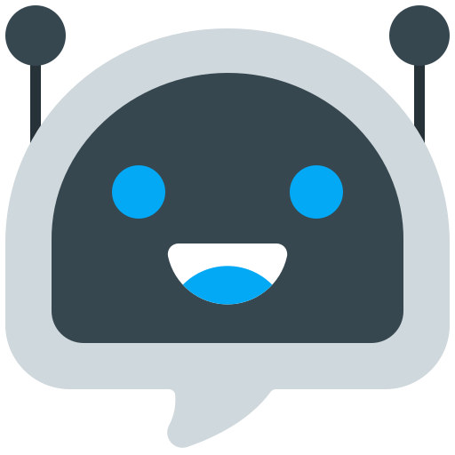

<p align="center">
  
</p>

<h1 align="center">FlowZen</h1>

<p align="center">
  <strong>An Intelligent Multimodal Android Assistant Powered by On-Device AI</strong>
</p>

<p align="center">
  
  
  
  
  
</p>

---

## 📌 Overview

**FlowZen** is an Android application designed for intelligent multimodal interaction. Combining text query processing, speech-to-text voice input, and image recognition, FlowZen provides an accessible, intuitive assistant interface. Built with an architecture aimed at on-device machine learning (TensorFlow Lite / LiteRT), it lays the foundation for edge AI inference with low latency and user privacy.

---

## ✨ Features

- **Multimodal Input Support:**
  - 💬 **Text Queries:** Type questions and commands directly into the prompt bar.
  - 🎙️ **Voice Recognition:** Speak naturally using built-in speech recognition (`RecognizerIntent`).
  - 🖼️ **Image Input:** Select images from your device gallery to run visual queries.
- **On-Device Machine Learning Foundation:**
  - Integrated with **TensorFlow Lite** and **TensorFlow Lite Task Audio**.
  - Prepared for **LiteRT / Gemma on-device LLM inference** (`.task` multimodal models).
- **Modern Dark UI Design:**
  - Streamlined, distraction-free conversational interface.
  - Responsive action buttons for voice, camera, and gallery.
  - Interactive prediction states and loading progress indicators.
- **Robust Android 14/15 Support:**
  - Target SDK 35 with scoped storage and media permission handling (`READ_MEDIA_IMAGES` / `READ_EXTERNAL_STORAGE`).

---

## 🏗️ Project Architecture

```
FlowZen/
├── app/
│   ├── src/
│   │   ├── main/
│   │   │   ├── java/com/example/multimodal_model_integration/
│   │   │   │   └── MainActivity.java       # Core UI and multimodal input handler
│   │   │   ├── res/
│   │   │   │   ├── layout/activity_main.xml # Main UI layout
│   │   │   │   ├── drawable/               # Icons & rounded UI backgrounds
│   │   │   │   └── values/                 # Colors, themes, and strings
│   │   │   └── AndroidManifest.xml         # App configuration & permissions
│   │   └── test/                           # Unit tests
│   └── build.gradle.kts                    # App dependencies & SDK configs
├── gradle/
│   ├── wrapper/                            # Gradle wrapper binaries
│   └── libs.versions.toml                  # Version catalog
├── settings.gradle.kts                     # Gradle repository configuration
├── build.gradle.kts                        # Root build configuration
└── chatbot.png                             # Application mascot / icon
```

---

## 🛠️ Tech Stack & Dependencies

- **Platform:** Android (Java / Kotlin)
- **Build System:** Gradle (Kotlin DSL `.kts`)
- **Minimum SDK:** API 24 (Android 7.0 Nougat)
- **Target / Compile SDK:** API 35 (Android 15)
- **Libraries:**
  - `androidx.appcompat:appcompat`
  - `com.google.android.material:material`
  - `androidx.constraintlayout:constraintlayout`
  - `org.tensorflow:tensorflow-lite:2.14.0`
  - `org.tensorflow:tensorflow-lite-task-audio:0.4.2`
  - `org.tensorflow:tensorflow-lite-gpu:2.14.0`

---

## 🚀 Getting Started

### Prerequisites

1. **Android Studio** (Hedgehog | Ladybug or newer recommended).
2. **Java Development Kit (JDK 11 or higher)**.
3. An Android device or emulator running **API 24 or newer**.

### Installation & Setup

1. **Clone the repository:**
   ```bash
   git clone https://github.com/gummybear29/FlowZen.git
   cd FlowZen
   ```

2. **Open in Android Studio:**
   - Launch Android Studio.
   - Click **Open** and select the root `FlowZen` folder.
   - Allow Gradle to sync dependencies automatically.

3. **Build & Run:**
   - Select your target device / emulator from the device toolbar.
   - Click the green **Run** (▶) button or execute:
     ```bash
     ./gradlew assembleDebug
     ```

---

## 🔐 Permissions

The app utilizes the following permissions defined in `AndroidManifest.xml`:

| Permission | Purpose |
| :--- | :--- |
| `android.permission.RECORD_AUDIO` | Enables voice-to-text queries via microphone |
| `android.permission.READ_MEDIA_IMAGES` | Accesses gallery photos on Android 13+ (API 33+) |
| `android.permission.READ_EXTERNAL_STORAGE` | Backward-compatible photo gallery access for legacy Android versions |
| `android.permission.CAMERA` | Captures images directly for visual analysis |

---

## 🗺️ Roadmap

- [ ] Connect LiteRT / Gemma 3B multimodal model for offline, on-device reasoning.
- [ ] Add streaming text response rendering in the chat UI.
- [ ] Support real-time audio analysis with TensorFlow Lite Audio Task.
- [ ] History and saved conversation threads.

---

## 📄 License

This project is open-source and available under the standard MIT License.
